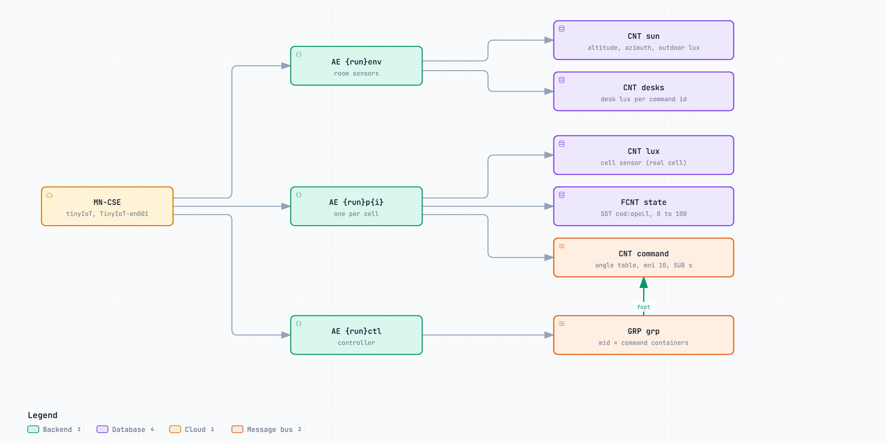
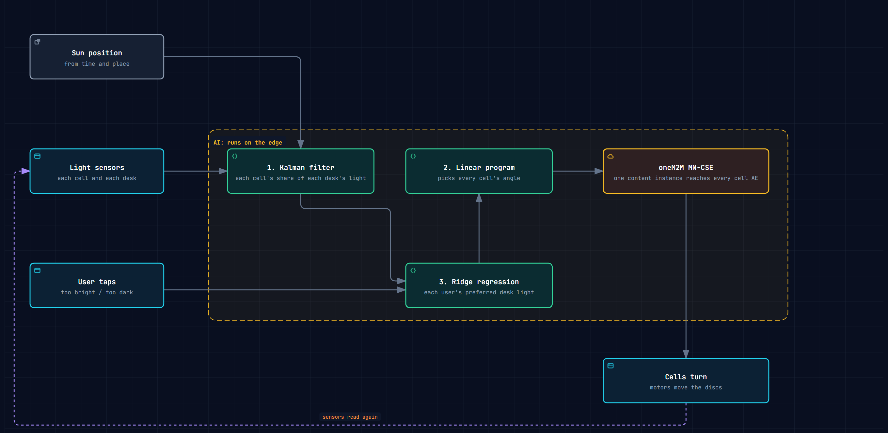

# PolaGrid

PolaGrid cuts glare at the desk without darkening the room. A window is divided into cells, each cell holds a rotating polarizing film, and an AI turns only the cells whose light lands on a desk. Each cell is a oneM2M AE, and the controller talks to the cells through a standard CSE: [tinyIoT](https://github.com/seslabSJU/tinyIoT) in an IN-CSE plus MN-CSE hierarchy. The same resource tree was also run on the [ETSI MEC Sandbox](https://try-mec.etsi.org/). The standard is described at [onem2m.org](https://www.onem2m.org/).

- Write-up: https://www.hackster.io/gustjr3332/polagrid-per-cell-window-dimming-with-onem2m-and-edge-ai-54ae9e
- Demo video (3 min): https://www.youtube.com/watch?v=S3Rqu0ENBUw



This repository is open source (MIT). It holds the edge AI, the ESP32 firmware for one real cell, the demo and phone-app mockup, and the hardware notes. It was built by one person for a university maker contest and submitted to the 2026 oneM2M International Hackathon.

## The problem

With the sun on a monitor or a book, most people pull the blind down, and then the room is dark enough that the lights go on. The sun also moves, so the blind goes up and down all day, and the seat next to you gets different light from the same window. Glare is about where the light lands, not how much of it there is.

Motorized blinds and electrochromic glass still act on the whole window or a whole pane. Reservation timers and room-wide brightness sensors cannot see that one desk is glared and the next is not.

## How it works

One cell is a fixed polarizing film on the inside of the glass plus a disc with a second film that a stepper motor turns from 0 to 90 degrees. At 0 the cell is open, at 90 it is closed, and the angle in between sets how much light passes. A cell never blocks the whole view: even fully open it passes at most about half the light of bare glass (a design assumption, not a measurement).

Each cell has a light sensor, and each desk has one. The cell is built from an ESP32, a 28BYJ-48 stepper, a timing belt and pulley, and two BH1750 sensors. The product idea is a control module per cell, sold one at a time, plus a central control module that ties them together.

```
desk sensor -> ESP32 (Bluetooth or Wi-Fi) -> MN-CSE (oneM2M) -> AI loop -> command -> disc turns
```

The CSE is tinyIoT in an IN plus MN hierarchy. A room's cells form one group, so one command per zone reaches every cell. If the link drops, a cell opens by itself after 60 seconds (the rule fired on the board in one Bluetooth run, but the disc opening itself is not shown on hardware yet), there is no camera anywhere, and at night the cells close.

The AI has three stages:

1. Contribution estimation. After installation the system works out how much each cell lights each desk, with no setup of window size or desk position.
2. Angle decision. It sets each cell's angle so no desk goes over the glare limit. It reads sensor values only.
3. Per-room learning. It predicts the next day from each room's own data, and a phone app lets users correct comfort settings. A pre-trained preference model for the real cell starts from 36 virtual-user samples and keeps learning from app corrections.



## oneM2M features used

- One AE per cell, one for the zone controller and one for the environment (sun and desk readings).
- Containers and content instances (`mni` 10): commands, desk readings and cell-sensor readings.
- A FlexContainer per cell (`state`) with the SDT module `cod:opeLl` (openLevel) for the cell's open level.
- Group fan-out: one CIN on the group's `fopt` commands every cell of a zone.
- Subscriptions and notifications over HTTP, and an MQTT binding in the firmware build (`env:mqtt`, host-tested only).
- Per-role ACPs (cell, controller, viewer), including the form of the originator when a request is forwarded by the IN (`/tinyiot/CAdmin`).
- Label-based discovery (`fu=1`): the controller and the app find cells by the label `polagrid/<run>/state`, not by name.
- IN-CSE and MN-CSE registration, with a zone's resources on the MN and requests also routed through the IN.
- MEC 011 data brought into the CSE by a bridge AE (`sw/edge_ai/tools/mec_bridge.py`).

## Results

Everything in this section except the real-cell rows is simulation.

Glare, in desk-hours per day (lower is better), 12-cell virtual room, 20-day mean, two desks summed:

| Controller | Glare | Note |
|---|---|---|
| Fixed open | 2.26 | |
| Timed schedule | 0.34 | |
| AI stages 1 and 2 | 0.06 | 0.44 desk-hours darker at the desk than fixed open |
| Blind | 0.00 | desk is dark longest, 21.2 h |

Stage 3: a model trained on another room has 3.04 to 4.12 h of glare. Retrained on 30 days of the room's own data it has 0.05 to 0.23 h.

Scale and resilience on one laptop (WSL, 8 threads), 1,000 virtual cells in 10 zones, one measurement series each:

- Command to angle p95 is 1.8 to 2.9 s when the zones run five at a time. Run all ten at once on this machine it is 4.4 to 6.7 s, which misses the 5 s target in two of four runs.
- Taking the IN down for 240 s left all 48 zone-control requests successful. Requests routed through the IN failed.

Real cell, one unit stuck to a window. Two sets of sweeps, one cell, one run each:

- 1 November, indoor and low light: after the closed angle was tuned from two sweeps, a closed cell reads 0.0 lux at the cell sensor behind the disc, against 113 to 132 lux open. The desk sensor falls from about 62 to 72 lux to 1.7 lux, roughly 2.7%. In a repeat sweep the same 0 degree point read 5% apart in one run and 42% apart in another.
- 19 November, sunlight, one run in 10 degree steps through the dashboard API: the cell sensor read 4,303 lux at command 0 and 817 lux at command 90 (motor at 33 degrees then), a cell-to-desk ratio of 0.87 falling to 0.14, and it was still falling at 90. The sky changed during the sweep (desk 3,941 to 6,964 lux) and the curve is not monotonic (30 degrees reads higher than 20). A sin^2 fit puts the dark end at motor 40 degrees, so `MOTOR_CLOSED_DEG` in `sw/actuator/src/cell_logic.h` is now 40.
- The film's true open position sits outside the motor's range, so "open" is only partly open. Treat all of these as single-run numbers from one cell.
- Bluetooth, 19 November: the board answered every command over Bluetooth, and the dashboard path moved the disc closed and open (watched by eye, not logged by a sensor). The link-loss rule fired on the board, but the motor was not turning in that run, so the disc opening by itself is not shown on hardware.

There is no saving figure for electricity here, because none was measured. The 20.6% (cooling) and 19.5% (lighting) share of Korean large-building electricity (2016, apartments excluded) is background, not something PolaGrid achieves.

## Run it

Quick start needs only Docker with Compose. The image builds tinyIoT from a pinned upstream commit plus the patch in `sw/edge_ai/sim/patches`, so the first build takes a few minutes.

```bash
docker compose up -d   # mosquitto, tinyIoT IN (3000), MN mn001 (3001), controller
docker compose logs controller   # "[setup] 12 cells on TinyIoT-mn001" means the first CIN is being written
docker compose down
```

If port 3000 or 3001 is already taken on your machine, set `IN_PORT` and `MN_PORT`, for example `IN_PORT=13000 MN_PORT=13001 docker compose up -d`.

To time the start instead, run `bash sw/edge_ai/tools/first_cin.sh` from the repository root. It starts the stack itself (do not run `up -d` first) and writes `sw/edge_ai/results/first_cin_<MMDD>.txt`.

Running without Docker needs a Linux shell (the project is developed on WSL Ubuntu), Python 3.12, and a tinyIoT build. Install the Python packages with `pip install -r sw/edge_ai/requirements.txt`. The tinyIoT patches, configs and node scripts are in `sw/edge_ai/sim`, and `sw/edge_ai/sim/README.md` explains how to build it.

Virtual 1,000-cell demo and the phone-app mockup:

```bash
cd sw/app_ui/demo
bash demo_up.sh virtual 10     # 10 zones of 100 cells, page at http://localhost:8000
bash preflight.sh 10           # checks the stack
bash demo_down.sh              # stops it
```

`demo_up.sh replay` plays a recorded day instead of running the zones live, which is faster than real time. Recordings are not in the repository: run `bash record_day.sh` once first (25 to 30 minutes, it writes `replay/day_10min.jsonl`), otherwise replay has nothing to play. The page follows Start, Stop, speed and cloud controls.

One real cell:

```bash
cd sw/app_ui/demo && bash demo_up.sh real                 # IN plus one MN
cd sw/edge_ai
python tools/bt_bridge.py --port COM4 --run real1          # Windows, paired Bluetooth COM port
python3 tools/real_cell.py --run real1 ai --close-lux 150  # AI loop, simulated sun, real desk sensor
```

The firmware is in `sw/actuator` and needs [PlatformIO](https://platformio.org/). Copy `src/secrets.example.h` to `src/secrets.h`, then `pio run -e bt -t upload` flashes the Bluetooth build over USB (there is no over-the-air update in that build). `env:esp32dev` is the Wi-Fi build and has not been re-tested since the Bluetooth work.

Tests:

```bash
cd sw/edge_ai && python -m pytest tests -q
cd ../actuator && g++ -std=c++17 -I src tests_host/test_logic.cpp -o test_logic && ./test_logic
```

## Layout

- `hw/`: wiring and architecture diagrams, parts list and build notes
- `sw/edge_ai/`: the `polagrid` package (physics model, AI stages, oneM2M client), tests, tools, `data/weather`, `sim/` (tinyIoT setup), `results/`
- `sw/actuator/`: ESP32 firmware, host-side tests, I2C scanner
- `sw/app_ui/`: phone-app mockup, demo server, classroom replay
- `compose.yaml`: the quick-start stack
- `LICENSE`: MIT

## Evidence and methods

Where each number above comes from. All files are in `sw/edge_ai/results/`; each run's date is in its file name (MMDD).

| Claim | File |
|---|---|
| Glare table (fixed open, timed, AI stages 1 and 2, blind) | `baseline_compare.csv` |
| Other-room model 3.04 to 4.12 h, retrained 0.05 to 0.23 h | `ai3_rooms_1017.txt` |
| 1,000-cell closed loop p95 1.8 to 2.9 s (five zones at a time), 4.4 to 6.7 s (ten at once) | `closed_loop_1000_repeat_1015.txt` |
| IN down for 240 s, 48 of 48 zone-control requests succeeded | `in_outage_1027*.csv` and `.log` |
| Real cell, closed angle sweeps, 1 Nov, indoor and low light: closed 0.0 lux behind the disc against 113 to 132 open, desk 62 to 72 lux down to 1.7 | `real_cell_sweep_1101_1505.csv`, `real_cell_sweep_1101_1516.csv` |
| Real cell in sunlight, 19 Nov, one run, 10 degree steps: cell sensor 4,303 lux at command 0 and 817 at command 90, still falling; the sky changed during the run and the curve is not monotonic. It does not show a repeatable transmission curve | `real_cell_sweep_1119_1117.csv` |
| Bluetooth, 19 Nov: the board answered every command; the dashboard path moved the disc closed and open (watched by the user); the link-loss rule fired (back to 0 after 77 s without PING). The motor was not turning in that run, so it does not show the disc opening by itself | `bt_cell_motion_failsafe_1119.txt` |
| ACME 10 req/s steady writes (1,000 AEs, 3,000 writes, default settings) | `bench_acme_0929_1942.txt` |
| tinyIoT MN steady writes: 69 req/s default, 458 req/s after the serialization patch, 577 req/s in a separate write-ahead-log configuration | `bench_tinyiot_mn_1001.txt`, `bench_tinyiot_mn_latest_1007.txt`, `bench_tinyiot_mn_wal_1001.txt` |
| Hosted MEC Sandbox, scenario `dep-opt-c`: four preconfigured ACME MN-CSEs answer with `cst=2` and hold a `<remoteCSE>` for the organizers' IN-CSE; MEC 011 and MEC 033 answer | `sandbox_dep_opt_c_1112.txt` |
| Same MN-CSE (mep1): AE, container, CIN and latest retrieval following TR-0086 clause 5.3 | `sandbox_dep_opt_c_5_3_1112.txt` |
| Same MN-CSE: our resource tree (ACP, AE, command container, `cod:opeLl` FlexContainer, label discovery, command round trip); all accepted except one subscription whose `nu` was not reachable from the sandbox | `sandbox_dep_opt_c_tree_1112.txt` |
| Same MN-CSE: controller AE, group with two command containers, one fan-out CIN reached both; an originator without rights got 403 | `sandbox_dep_opt_c_grp_1112.txt` |
| MEC services through oneM2M: a bridge AE on a tinyIoT MN-CSE copied the Sandbox's MEC 011 service list (seven services, all active) and platform time into two containers; a viewer originator read them back by label, and an originator in no rule got 403 | `mec_bridge_sandbox_1117.txt` (live Sandbox), `mec_bridge_local_1117.txt` (local stub) |
| Same bridge, local stub MEC platform: the zone controller subscribed to the service list and was notified of exactly the one service that disappeared | `mec_bridge_sub_local_1118.txt` |

The ACME and tinyIoT runs are one laptop, one run each, and the settings differ between files, so quote them with their file. The Sandbox runs are one run each on one cell (two for the group), with request and response logs, the sandbox id masked. The 577 figure is from the write-ahead-log configuration of 1 October; the latest build measured 458.

The three AI stages, and what is implemented here and what is a library call:

| Stage | Method | Implementation |
|---|---|---|
| 1. Cell contribution | Kalman filter on the correction to each cell's contribution to each desk | Implemented here with numpy (`polagrid/online.py`); initial estimate by scipy `nnls` |
| 2. Angle decision | Linear program: glare, missing lux and motor moves | Library: scipy `linprog(method="highs")` (`polagrid/ai.py`) |
| 3. Per-user preference | StandardScaler + Ridge on the user's brighter/darker corrections | Server: scikit-learn. Browser: own JavaScript (`sw/app_ui/mockup/ridge.js`), checked against scikit-learn by `tests/test_ridge_js.py` |

The Kalman filter's uncertainties (initial 3,000 lux, drift 300 lux per step, measurement noise 2% of the mean desk reading plus 25 lux squared) were tuned in the virtual room, not measured on the real sensor.

Twelve-cell room view: open `sw/app_ui/mockup/index.html?room=12` (add `&live=1` with `demo/server.py --real RUN` to show the real cell as the first cell). One real cell plus eleven virtual cells; sun on the right two columns. A cell closes when its lux is at or above the limit (default 2,000, the real cell's full-close threshold; change it in the page or with `?thr=`). The virtual cells' lux values are assumptions, not measurements.

## Data credits

The weather CSVs in `sw/edge_ai/data/weather` come from Open-Meteo.com (ERA5 reanalysis), licensed CC BY 4.0. The source's free API tier is for non-commercial use; see `SOURCE.txt` next to the files.

## Status and limits

This is a prototype. What is not done:

- The `docker compose up` quick start reached the first CIN in 176 s with a cold rebuild and 10 to 11 s warm (three runs on one PC, base images already cached). From a fresh clone of this repository with a cold rebuild it took 110 s (18 November, one run, `first_cin_1118_clone_cold.txt`). The first CIN comes from the controller setup, not from a closed-loop run.
- The 1,000 cells are virtual. Only one real cell exists.
- The real cell's AI loop closes by a desk-lux threshold. The rule reads a falling desk value as a reason to reopen, so with a continuous flashlight the cell can open and close in a loop. A minimum hold time after closing would fix it, and it is not written yet.
- The ACP hardening, TLS and SAREF mapping planned for the contest are not in this repository.
- MEC deployment is only partly done. On the hosted Sandbox we used the preconfigured `dep-opt-c` scenario and registered our own AEs, ACP and group on its ACME MN-CSE. We did not deploy our own container there, because the hosted page has no scenario editor, and we did not test notification delivery into the Sandbox. We did not check from the IN-CSE side that our resources are visible, because that needs an account we do not have.
- MEC services reach oneM2M through a small bridge AE (`sw/edge_ai/tools/mec_bridge.py`). It reads MEC 011 on the Sandbox and writes the service list and the platform time into the tinyIoT MN-CSE, where other AEs find them by label. It ran once against the live Sandbox, from a laptop and with certificate verification off. Locally, against a stub MEC platform, the zone controller subscribed to the service list and was notified when a service disappeared (`watch` mode); that was not repeated against the live Sandbox. tinyIoT asks for CREATE before it accepts a subscription, so the controller may also write into those containers. The controller reports changes and does not act on them yet.
- tinyIoT cannot register to a public IN-CSE over HTTPS with Basic auth by itself (no TLS, no Authorization header, IP addresses only). A reverse proxy next to the MN would work according to the tinyIoT maintainers; we did not build it. MEC-IPE does not work with tinyIoT, so on tinyIoT the bridge AE above stands in for it.
- The ESP32 MQTT firmware passes host tests and a fake-cell run. It has not run on real hardware against a real broker.

## oneM2M and related projects

- oneM2M, the IoT service-layer standard PolaGrid is built on: https://www.onem2m.org/
- tinyIoT, the CSE used for the IN and the MN-CSEs here: https://github.com/seslabSJU/tinyIoT
- ACME, the CSE inside the ETSI MEC Sandbox scenario: https://github.com/ankraft/ACME-oneM2M-CSE
- ETSI MEC Sandbox: https://try-mec.etsi.org/

## Contributing

Issues and pull requests are welcome. For code changes, run the tests above first. Do not commit secrets, `secrets.h`, MEC Sandbox session URLs or database files.

## License

MIT, see `LICENSE`.
