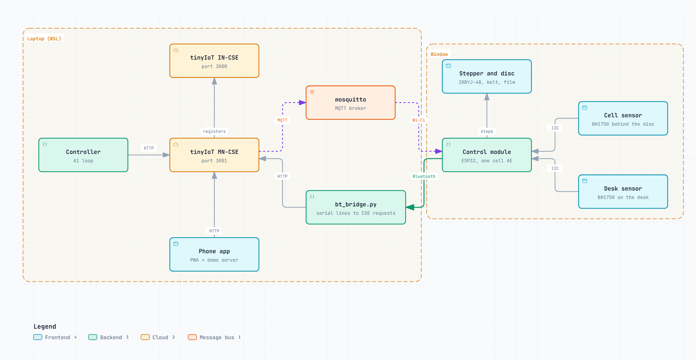
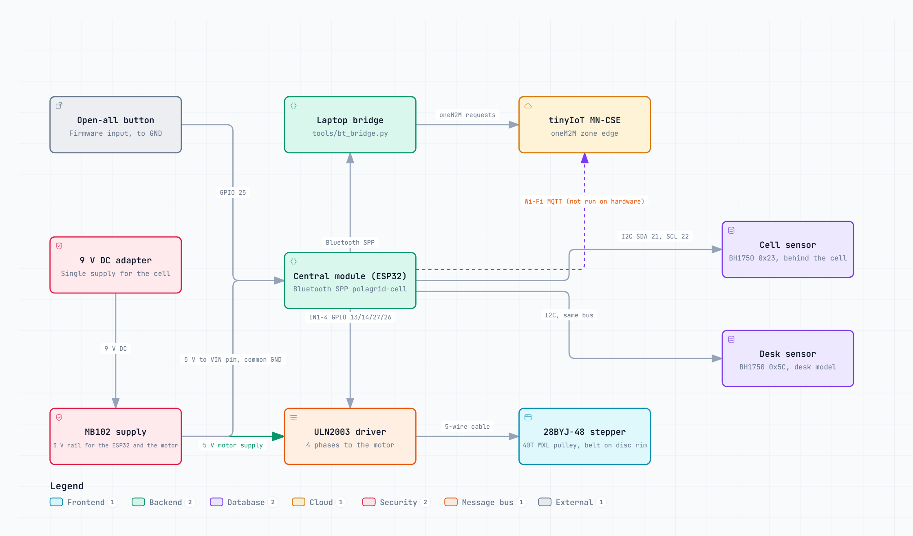

# hw
Hardware of one polarizer window cell: circuits, parts and mechanical design.

## Product concept
The product idea is one central control module plus one control module per cell, sold one at a time. A control module is a square cell the user sticks
on the window, and the user buys as many as the window needs. The demo hardware is one central module and one control
module, built into a picture frame that stands in for the window (the frame's inner glass area is one cell).

## Cell design (round acrylic disc, timing belt)
Geometry is calculated or read from the order list. Only the sensor sweeps in `sw/edge_ai/results/` are measured.

| Part | Value |
|---|---|
| Round acrylic disc | O179 mm |
| Picture frame | square, 178 mm opening that widens toward the back |
| Timing pulley | MISUMI C-ATP40MXL019-B-P5, 40 teeth, MXL (2.032 mm pitch), pitch diameter 25.9 mm |
| Timing belt | BANDO 76MXL3.2, 76 teeth, 3.2 mm wide, about 154 mm long |
| Motor | 28BYJ-48 with ULN2003 driver |

- The disc (179 mm) is 1 mm larger than the frame opening (178 mm). This works because the frame widens toward the back,
  so the disc seats behind the narrow front opening and the visible area is the 178 mm opening.
- The belt is a closed loop. It is cut open and glued teeth-outward on the disc rim. At a belt pitch radius of about
  90.4 mm (disc radius 89.5 mm plus an estimated 0.9 mm), 154 mm covers an arc of about 98 deg, enough for the 90 deg stroke
  plus a few degrees of margin.
- Drive ratio is belt pitch radius over pulley pitch radius: 90.4 / 12.94, about 6.99. With 4,096 half steps per motor turn
  that is about 79 half steps per degree of disc (`STEPS_PER_DISC_DEG` in `sw/actuator/src/cell_logic.h`). The 0.9 mm and
  the 4,096 are estimates.
- Pulley position: centre distance is about 103.3 mm (belt pitch radius plus pulley pitch radius). The pulley flange diameter
  is not in the order list; it has to stay under about 32 mm, or the pulley touches the frame wall.
- A servo does not work here: 180 deg at the pulley is only about 26 deg at the disc.
- Transmission is about T_single^2 x cos^2(theta) between the two films (Malus). Measured sweeps are listed in the root `README.md`.
- No homing: there is no stop on the round disc, so the firmware does not home (`HOME_OVERDRIVE_DEG` = 0). The disc position
  at power-up is 0 deg, so set the disc open by hand before power-on.

## Parts

| Part | Qty | Note |
|---|---|---|
| ESP32 DevKit | 1 | Bluetooth or Wi-Fi build, see `sw/actuator/README.md` |
| 28BYJ-48 stepper with ULN2003 driver | 1 | |
| BH1750 light sensor | 2 | 0x23 behind the disc (ADDR to GND), 0x5C on the desk (ADDR to 3V3) |
| MB102 breadboard power module | 1 | set to 5 V |
| 9 V 1 A DC adapter | 1 | feeds the MB102 |
| MISUMI C-ATP40MXL019-B-P5 pulley, 40T MXL | 1 | |
| BANDO 76MXL3.2 timing belt | 1 | cut open and glued to the disc rim |
| Clear acrylic disc, 179 mm | 1 | |
| Square frame, 178 mm opening, widening toward the back | 1 | |
| Polarizing film | 2 layers | one on the glass, one on the disc |
| Breadboard and jumper wires | 1 set | |

## Wiring

- Motor pins: GPIO 13, 14, 27, 26 to ULN2003 IN1 to IN4. GPIO 12 is a strapping pin and is not used.
- I2C: SDA GPIO 21, SCL GPIO 22 for both BH1750.
- Open-all button: GPIO 25 to GND, internal pull-up.
- Power: the 9 V adapter feeds the MB102, whose 5 V rail powers the ULN2003 and the ESP32 VIN pin. All grounds are common.
- USB is only for flashing. Pull the ESP32 5V jumper and switch the MB102 off first.

## Build sequence
1. Frame: fix the first polarizing film on the glass.
2. Disc: stick the second film on the 179 mm disc.
3. Cut the belt open and glue the strip teeth-outward on the disc rim (about 98 deg of rim).
4. Seat the disc behind the frame opening.
5. Place the pulley about 103 mm from the disc centre so it meshes with the belt strip, and mount the motor behind it.
6. Wire the ESP32, ULN2003 and both BH1750 as in the diagram, with the single supply.
7. Set the disc open by hand, then power on.
8. Flash with `pio run -e bt -t upload` (PlatformIO) while the motor supply is off.

## Open points
- The films are cut by hand, so edges and axis alignment are not exact.
- There is no end stop or homing. A disc that is not open at power-up shifts every angle.
- The layers are fixed with tape or glue, which is not a finished assembly.
- Not measured: belt slip and backlash, friction of the disc against the frame, and light lost in the acrylic disc.
