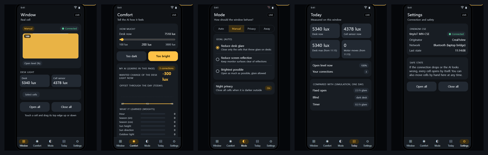

# app_ui: PolaGrid phone-app mockup, demo server and classroom replay

This folder holds an HTML mockup of the phone app (`mockup/`), the demo server and 1,000-virtual-cell demo page (`demo/`), and a 3D classroom replay (`classroom/`). There is no installed app. The mockup shows the window's cells and the desk light, and lets the user correct the AI. It talks to the oneM2M CSE
only, never to the cells or the AI controller directly. Today there is one real cell (ESP32, stepper motor); the other cells in the demo are virtual, up to 1,000.

## Scope

In the mockup: see the window, change the mode, say "too bright / too dark", move a single cell by hand, see today's numbers.
Out of scope: accounts, multiple windows, push notifications, anything that needs a number we have not measured.

## Screens

1. **Window** (home). The cell grid (3 x 4 in the mockup), each cell filled by its open level (`cod:opeLl`, 0 to
   100). Below it the desk light per desk in lux, the mode chip, and a connection badge. Tap a cell for manual control.
2. **Comfort**. Two big buttons, "Too bright" and "Too dark", plus a slider for how much (about 100 to 500 lux). Each
   press is one correction: it is sent to the controller and also kept as a training sample for the AI (3) preference model.
   With `?live=1` the Comfort screen also shows "My AI": the page learns the preference itself (`mockup/ridge.js`, Ridge in the browser), draws the wanted offset now and over the day, and posts the model to the demo server (`/api/real/params`). `tools/real_cell.py ai --pref web` aims the cell with it. Web demo only: no installed app.
3. **Mode**. Auto, Manual, Privacy (all cells closed at night), Away (all open). Auto is the default. Manual keeps the
   AI out until the user switches back or the timer ends.
4. **Today**. Measured values only: glare hours, hours the desk was below target, number of corrections, motor moves.
   No savings figures until we have measured ones (project rule).
5. **Settings**. CSE address, originator, connection test, language, safe-state explanation.

Manual cell control: one cell, an angle slider, and "Open all" / "Close all". An unreachable CSE never leaves cells
closed: cells return to the open state on their own (project safety rule), and the app shows that state.

## Data flow (oneM2M)

| App action | Resource | Operation |
|---|---|---|
| Read cell levels | cell `state` FlexContainer (`cod:opeLl`), found by label `polagrid/<run>/state` | discovery (`fu=1`), then GET |
| Read desk light, sun | `env/desks`, `env/sun` containers | GET `/la` every 3 s (polling), subscription later |
| Mode, correction, manual cell | new container `ctl/app` (CIN with `{type, ...}`) | POST CIN |

The controller subscribes to `ctl/app` and applies the request. This needs two things on the CSE side that do not
exist yet: the `ctl/app` container and an ACP for a new originator `C<run>app` with read on state, desks and sun, and
create on `ctl/app` only. The existing viewer role (read and discover only) is the base.

## Stack

Plain HTML, CSS and JavaScript in `mockup/` and `demo/static/`, served by `demo/server.py` (Python). The page polls the demo server, which reads the CSE over HTTP. UI text is Korean or English.

## Screen mockup

`mockup/index.html` is an HTML mockup of the five screens in a phone frame, with made-up numbers labelled "DEMO DATA" unless `?live=1` is set. Open it in
Chrome: `?s=0..4` shows one screen (0 Window, 1 Comfort, 2 Mode, 3 Today, 4 Settings), `?view=all` shows all five. The Mode
screen puts the three goals from the proposal (reduce desk glare, reduce screen reflection, brightest) under Auto.
There is no native Android or iOS app; the mockup runs in a browser and can be added to a phone's home screen (below).

### Live mode (`?live=1`)

Live mode reads the real cell through `demo/server.py`. Serve the page from that server in WSL, with `--real RUN`:
`python3 server.py --live --mns 1 --real real1`, then open `http://localhost:8000/mockup/?live=1`. Start `tools/fake_cell.py --run real1`
first to try it without hardware (the page then says "FAKE CELL").

- Checked on 19 Nov 2026 with tinyIoT and the real ESP32 over Bluetooth: every screen shows live values.
- Window: the cell's open level, desk lux and cell-sensor lux, read every 2 s from `/api/real` (viewer GETs only). Cells appear one by one at the row and column set in the firmware (`CELL_ROW`, `CELL_COL`, label `polagrid/<run>/pos/<row>/<col>`), with dashed boxes for empty places. A cell cannot be removed from the screen except by deleting its resources on the CSE.
- Moving cells: touch a cell and drag its top edge (steps of 5 %), or tick cells with "Select cells" and use one slider for all of them. The page POSTs `{level, i}` or `{level, cells}` to `/api/real/level`; `server.py` forwards it to `tools/real_cell.py --run real1 app` (127.0.0.1:9600), which posts one command CIN per cell. "Open all" / "Close all" use the same endpoint. The endpoint has no login, so use it on a trusted Wi-Fi only.
- Comfort: "Too bright" and "Too dark" (100 to 500 lux, scaled to the desk reading) POST `/api/real/correction`. `server.py` stores one row per correction in `demo/corrections.db` (SQLite, git-ignored), and `python3 tools/fit_corrections.py` fits a preference model from them. The controller does not use that model yet. "My AI" learns the preference in the browser (`mockup/ridge.js`) and posts it to `/api/real/params`; `tools/real_cell.py ai --pref web` aims the cell with it.
- Today: desk and cell lux now, the desk maximum and motor moves since the page opened, and the correction count. Only the comparison with fixed open, blind and timer is simulation, and it is labelled so.
- Settings: the CSE link, the viewer originator, Bluetooth and the time of the last state.
- Mode: the Mode buttons send nothing; the screen marks Manual, because the live stack runs `real_cell.py app`. The goal and brightness controls are still made-up values.
- Not tried on a phone: the cell list and Wi-Fi icon.

Dashboard in live mode: live values from the real cell, 19 Nov.

### Phone install (PWA)

- The mockup has a manifest and an apple-touch-icon, so Safari on an iPhone can add it to the home screen (Share, Add to Home Screen) and it opens full screen.
- Open `http://<PC IP>:8000/mockup/?live=1` from the phone on the same Wi-Fi first. WSL needs a port proxy to the PC's IP: run `demo/phone_proxy.ps1` in an admin PowerShell (`-Remove` undoes it).
- With `?bare` the page fills the screen height (`100dvh`), so nothing is cut off on a short phone. Checked in headless Chrome at 390 x 844.

### Access token

`demo/server.py --token T` (or `DEMO_TOKEN`) makes every POST need the header `X-Demo-Token`. The pages read `?token=...` from their address and keep it in localStorage. `demo/demo_up.sh` generates one per start and prints the links. Details in `demo/README.md`.

### Rooms on the demo page

`demo/static/index.html` draws the 1,000 cells as ten 10 x 10 rooms (5 across, 2 down, labelled "Room 1" to "Room 10", row 0 at the bottom as in `physics.py`) when the frames come from a server. The built-in generator (no server) keeps a flat grid. Checked on a recording at 1,920 x 1,080: every room shows one dark patch where the sun lands, the same shape in all rooms because the ten zones run the same model and sun.

## Virtual lecture room (3D replay)

`classroom/index.html` shows a simulated lecture room whose south window starts 2.2 m above the floor, so nobody
can reach a blind. It opens straight from disk (no server, no internet, no library: a small canvas perspective
renderer). Two panes compare methods side by side over one day (default: bare glass vs PolaGrid AI (1)+(2)); use the
time slider, Play, drag to orbit and the wheel to zoom. `?lang=en` for English labels, `?t=<step>&still=1` for a fixed frame.

- Data: `classroom/classroom_data.js`, written by `python tools/classroom_sim.py` in `sw/edge_ai` (about 13 min; summary in
  `sw/edge_ai/results/classroom_<mmdd>.txt`). Every room value is an assumption and the numbers come from the
  physics model, not from measurement.
- Video: `python classroom/make_gif.py [--lang en] [--every 2]` takes one headless Chrome screenshot per step and joins
  them into `classroom/video/*.gif` (git ignored). No ffmpeg is needed; for MP4, run ffmpeg on `video/frames/*.png`.
